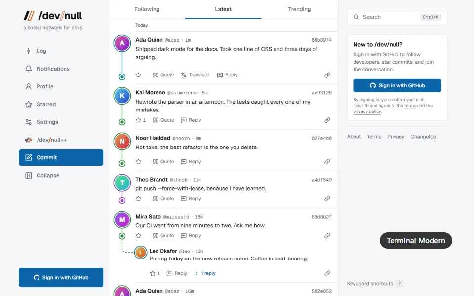

<h1 align="center">dev/null++</h1>

Extra powers for <a href="https://dev-null.sh">dev-null.sh</a>, the social network for developers. 
<picture><source media="(prefers-color-scheme: dark)" srcset="docs/media/intro-dark.webp"></picture>

## Features

Each has a switch under **/dev/null++** in the site's menu. All are on from the start, except themes, which you pick.

<picture><source media="(prefers-color-scheme: dark)" srcset="docs/media/themes-dark.webp"></picture> <b>Themes</b> Five complete looks for the whole site: Terminal Modern, Neo Tokyo, Encyclopedia, Sugar Cloud and Retro OS. Or make your own: the brush on the page's edge opens an editor, and the page shows each change as you make it.

<table align="left"><tr><td valign="top"><picture><source media="(prefers-color-scheme: dark)" srcset="docs/media/rewrite-dark.webp"></picture> <b>Rewrite with AI</b> Improve, shorten or fix a draft in the composer. Bring your own AI key.</td></tr></table>
<table align="left"><tr><td valign="top"><picture><source media="(prefers-color-scheme: dark)" srcset="docs/media/preview-dark.webp"></picture> <b>Link preview</b> Press and hold a link to open it over your log, at any width.</td></tr></table>
<table align="left"><tr><td valign="top"><picture><source media="(prefers-color-scheme: dark)" srcset="docs/media/peek-dark.webp"></picture> <b>Image peek</b> Press and hold an image to see it big. Let go and it goes back.</td></tr></table>
<table align="left"><tr><td valign="top"><picture><source media="(prefers-color-scheme: dark)" srcset="docs/media/pip-dark.webp"></picture> <b>Picture-in-picture</b> Videos float to a corner as you scroll, even across pages.</td></tr></table>
<table align="left"><tr><td valign="top"><picture><source media="(prefers-color-scheme: dark)" srcset="docs/media/commits-dark.webp"></picture> <b>New commits</b> At the top of your log, new commits load by themselves.</td></tr></table>
<table align="left"><tr><td valign="top"><picture><source media="(prefers-color-scheme: dark)" srcset="docs/media/follow-dark.webp"></picture> <b>Who to follow</b> A stack of cards. Swipe one away, follow from the card.</td></tr></table>
 

## Install

Download from the [latest release](https://github.com/aaqidmasoodi/dev-null-plus-plus/releases/latest). Chrome, Edge, Brave: unzip, open `chrome://extensions`, turn on **Developer mode**, **Load unpacked**. Firefox 140+: drag the `.xpi` into a window.

[Development](docs/DEVELOPMENT.md) · [Security](SECURITY.md) · [Logo licence](LOGO.md) · MIT
